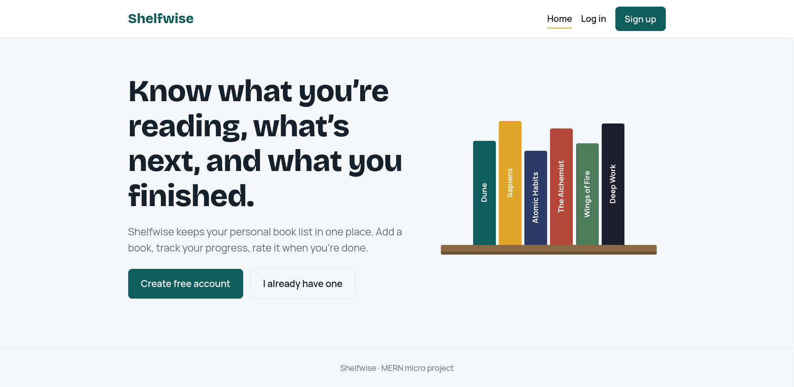
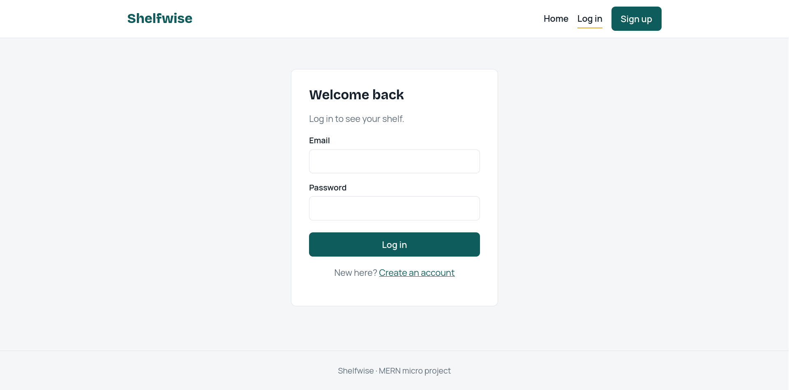

#  Shelfwise – MERN Stack Book Library

A simple full stack web application built with the **MERN stack** (MongoDB, Express.js, React.js, Node.js).
Users can register, log in and manage a personal reading list — add books, track whether they are *To read*, *Reading* or *Finished*, rate them, search and filter.

> Term Work-2 · Micro Project: *Design and implement a Simple Full Stack Web Application using MERN Stack*

---

##  Features

- **Home page** – landing page with sign-up / log-in call to action
- **User registration & login** – passwords hashed with bcrypt, sessions via JWT
- **Protected routes** – only logged-in users can open the Books page
- **Data display page** – responsive card grid of the user's books with live search and status filter
- **Full CRUD** – Create, Read, Update and Delete books
- **MongoDB integration** – Mongoose models for users and books
- **Per-user data** – each user sees only their own books
- **Responsive design** – works on mobile, tablet and desktop

##  Tech Stack

| Layer | Technology |
|---|---|
| Frontend | React 18, Vite, React Router, Axios, CSS |
| Backend | Node.js, Express.js |
| Database | MongoDB with Mongoose |
| Auth | JSON Web Tokens (JWT), bcryptjs |

##  Project Structure

```
mern-book-library/
├── client/                    # React frontend (Vite)
│   ├── index.html
│   ├── vite.config.js         # dev proxy: /api -> http://localhost:5000
│   └── src/
│       ├── components/        # Navbar, BookForm, ProtectedRoute
│       ├── context/           # AuthContext (login state)
│       ├── pages/             # Home, Login, Register, Books
│       ├── api.js             # Axios instance with JWT header
│       ├── App.jsx
│       ├── main.jsx
│       └── index.css
├── server/                    # Express backend
│   ├── config/db.js           # MongoDB connection
│   ├── middleware/auth.js     # JWT verification
│   ├── models/                # User.js, Book.js
│   ├── routes/                # auth.js, books.js
│   ├── .env.example           # sample environment variables
│   └── server.js
├── docs/screenshots/          # screenshots used in this README
├── .gitignore
├── LICENSE
└── README.md
```

##  Prerequisites

- [Node.js](https://nodejs.org/) v18 or newer
- [Git](https://git-scm.com/)
- MongoDB — use **one** of:
  - Local MongoDB / Docker: `docker run -d -p 27017:27017 --name mongo mongo:7`
  - A free [MongoDB Atlas](https://www.mongodb.com/atlas) cluster

##  Getting Started

### 1. Clone the repository
```bash
git clone https://github.com/<your-username>/mern-book-library.git
cd mern-book-library
```

### 2. Set up and start the backend
```bash
cd server
npm install
cp .env.example .env      # Windows: copy .env.example .env
```
Open `server/.env` and set your values:
```env
PORT=5000
MONGO_URI=mongodb://127.0.0.1:27017/shelfwise
JWT_SECRET=replace_with_a_long_random_string
```
Start the server:
```bash
npm run dev
```
You should see:
```
Server running on http://localhost:5000
MongoDB connected
```

### 3. Set up and start the frontend
Open a **second terminal**:
```bash
cd client
npm install
npm run dev
```
Open **http://localhost:5173** in your browser.

> Both terminals must stay running at the same time.

##  API Endpoints

| Method | Endpoint | Description | Auth required |
|---|---|---|---|
| POST | `/api/auth/register` | Create a new account | No |
| POST | `/api/auth/login` | Log in and receive a JWT | No |
| GET | `/api/auth/me` | Get the current user | Yes |
| GET | `/api/books?search=&status=` | List the user's books | Yes |
| POST | `/api/books` | Add a book | Yes |
| PUT | `/api/books/:id` | Update a book | Yes |
| DELETE | `/api/books/:id` | Delete a book | Yes |
| GET | `/api/health` | Server health check | No |

Protected requests send the header `Authorization: Bearer <token>`.

##  Database Schema

**User**
| Field | Type | Notes |
|---|---|---|
| name | String | required |
| email | String | required, unique |
| password | String | hashed with bcrypt |

**Book**
| Field | Type | Notes |
|---|---|---|
| user | ObjectId (ref User) | owner of the book |
| title | String | required |
| author | String | required |
| genre | String | default `General` |
| status | String | `To read` / `Reading` / `Finished` |
| rating | Number | 0–5 |
| notes | String | optional |

##  Screenshots

Add your screenshots to `docs/screenshots/` and the images below will appear on GitHub.

| Home | Login |
|---|---|
|  |  |

| Books (data display) | Add / Edit |
|---|---|
|  |  |

##  Troubleshooting

| Problem | Fix |
|---|---|
| `Could not sign up. Is the server running?` | Start the backend (`cd server && npm run dev`) and confirm `MongoDB connected` appears |
| `MongoDB connection failed: ECONNREFUSED` | MongoDB isn't running. Start Docker/MongoDB, or use an Atlas connection string in `.env` |
| `.env.example: No such file` | You are in the wrong folder. Run `cd server` from the project root first |
| `Port 5173 is in use` | Another Vite instance is running. Stop it with `Ctrl + C` |
| `secretOrPrivateKey must have a value` | `server/.env` is missing or `JWT_SECRET` is empty |

##  Security Notes

- Never commit `server/.env` (already listed in `.gitignore`).
- Passwords are hashed with bcrypt before they are stored.
- Use a long random `JWT_SECRET` in any real deployment.

##  Author

**Your Name** – Roll No. XXXX – Your Class / Division
Subject: Full Stack Development – Term Work-2

## 📄 License

This project is released under the [MIT License](LICENSE).
